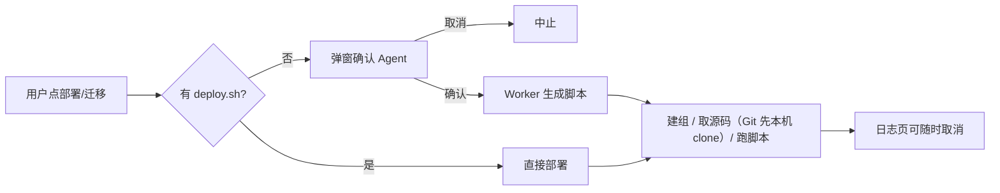

# SSE Deploy：K8s 迁移、环境变量与 Agent（2026-08）

> **版本**：v1.0  
> **日期**：2026-08-21  
> **父文档**：[SSE Deploy 云部署平台](https://ssemarket.cn/iwiki/space/space-YVgw7lRu/page/page-6AJU0Fyf)  
> **读者**：平台用户 + 管理员  

本文汇总 2026-08 起默认走 sseinfra/K8s 后的关键能力变更。

---

## 1. 默认运行时

- 默认 `DEPLOY_RUNTIME=sseinfra`：Git 与压缩包都进**学生组容器**  
- 组内 **无 Docker**，靠仓/包根 **`deploy.sh` + supervisord**  
- 本机 `docker compose` 仅作兼容开关  
- **Git 部署**：先在 sdpy-api 本机 `clone`，再按压缩包同一条链路 `tar → kubectl cp → supervisord` 进组（组内不再自行 clone，也不走面板 `addDeploy/runDeploy`）



---

## 2. Agent 使用约定

| 场景 | 是否先确认 | 可否取消 |
|------|------------|----------|
| 缺 `deploy.sh`（部署/迁移） | **是**，弹窗确认 | 确认前取消；入队后日志页取消 |
| 手动「部署 Agent」 | 用户主动点 | 关闭弹窗即可 |
| compose 构建自愈 | 部署弹窗勾选即可 | 取消整次部署 |

工具：`list_dir` / `read_file` / `get_write_boundary` / `write_file` / `done`。  
硬边界：只改配置与部署脚本，不改业务源码。

管理台须配置 OpenAI/vLLM 端点（支持 tools）。

---

## 3. 测试 / 正式隔离

| 维度 | test | prod |
|------|------|------|
| 数据目录 | `MODULE_DATA_ROOT/{模块}/test` | `.../prod` |
| 环境变量 | 分槽配置 | 分槽；晋升不复制 |
| K8s 组 | `{prefix}-{模块}-t` | `{prefix}-{模块}-p` |

- 模块页 **环境变量**：JSON / `.env` → 部署写根目录 `.env`  
- 模块页 **下载数据**：导出当前环境宿主机 MODULE_DATA zip  

迁移：同步本机 MODULE_DATA → Pod `/home/cloud/data`，再部署，成功后停旧 compose；宿主机数据保留备份。

---

## 4. 组默认规格（管理员）

新建组默认：**CPU 2 / 内存 4Gi / 存储 10Gi**（test、prod 各一组，规格相同）。

调配：

1. 管理台 → sseinfra →「新建组默认规格」  
2. 或 env：`SSEINFRA_DEFAULT_CPU`、`SSEINFRA_DEFAULT_MEM`、`SSEINFRA_DEFAULT_STORAGE`  

仅影响**新建组**；已有组在 sseinfra 面板改。

---

## 5. 现网上线要点

```bash
npm run build
# 拷前端到公网 nginx 挂载的 /sdpy 静态目录
docker compose up -d --build   # sdpy-api 所在目录
docker exec sse_market_server-nginx_proxy-1 nginx -s reload
```

---

## 6. 仓库对照

| 主题 | 路径 |
|------|------|
| 用户约定 | `docs/用户部署约定.md` |
| 流水线 | `docs/plans/2026-08-21-K8s部署流水线.md` |
| Agent 确认 / 组规格 | `docs/notes/2026-08-21-Agent确认与组规格.md` |
| 环境变量分槽 | `docs/notes/2026-08-21-模块环境变量分槽.md` |
| 数据下载 | `docs/notes/2026-08-21-下载模块数据压缩包.md` |
| 迁移 | `docs/notes/2026-08-21-旧服务数据迁移K8s.md` |
| **2026-09 更新** | `docs/notes/2026-09-11-部署流水线可靠性修复与sseinfra客户端JSON-API迁移.md` |
| **面板 SPA 改造方案** | `docs/plans/2026-09-09-sseinfra-API直连改造方案.md` |

---

## 7. 修订记录

| 版本 | 日期 | 说明 |
|------|------|------|
| v1.0 | 2026-08-21 | 初稿 |
| v1.1 | 2026-09-11 | Git 部署改为「本机 clone 后走压缩包链路」；面板 SPA 重构适配（JSON API）；补充流水线可靠性修复（见下方小结） |

### v1.1 变更小结（2026-09）

| 主题 | 变化 |
|------|------|
| **Git 部署** | 不再调面板 `addDeploy/runDeploy`（其不写 supervisord 配置，导致 `status=UNLOADED` / `(无日志)`）。改为本机 `clone` → `tar` → `kubectl cp` → 组内 `supervisord` |
| **sseinfra 客户端** | 面板 SPA 重构后旧 HTML 抓取失效，改为 JSON API（`POST /api/auth/login` + session cookie，`/api/*` 豁免 CSRF，组→pod） |
| **Web/SSH 端口** | 新面板 API 不暴露 nodeport，改由宿主机 frps dashboard `/api/proxy/tcp` 解析 |
| **环境变量同步** | 面板每写一个键都会 `rollout restart`，同秒第二次被 K8s 判冲突（HTTP 400）。已加写入节流 + 冲突重试，避免变量丢失 |
| **Pod 就绪** | 写 env 会整体替换 Pod，`kubectl cp` 前改为等待 rollout 收敛并跳过正在删除的 Pod |
| **大包传输** | 跳板→GPU 走 Tailscale DERP 中继（慢），部署路径超时由固定 5min 改为**按体积计算**（至少 30min 或 15s/MB），并输出进度 |
| **就绪探测** | 支持指定探测 URL + 严格模式（要求 2xx 且响应体非空，即「前端有内容」），并支持 http→https 自动升级 |
| **流水线展示** | Git 部署展示多一步「拉取代码」；Agent 步骤在 Git 场景正确显示「跳过」 |
