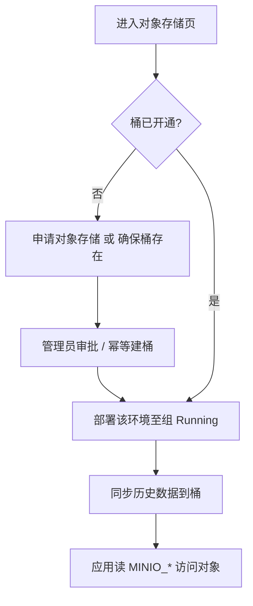

# SSE Deploy：对象存储（MinIO）用户手册

> **版本**：v1.1  
> **更新日期**：2026-08-22  
> **状态**：内测  
> **入口**：https://ssemarket.cn/sdpy/  
> **父文档**：[SSE Deploy 云部署平台](https://ssemarket.cn/iwiki/space/space-YVgw7lRu/page/page-6AJU0Fyf)  
> **配套**：[用户部署指南](https://ssemarket.cn/iwiki/space/space-YVgw7lRu/page/page-i_4t1QsZ)

---

## 1. 这是什么

模块业务里的**大文件**（如图床原图、缩略图）建议放在 sseinfra 的 **MinIO 对象存储**，不要把 PVC / 组磁盘塞满。

| 说法 | 实际 |
|------|------|
| 「像文件夹」 | 对象 **key** 可用斜杠，如 `images/2026/08/21/a.png` |
| 真目录挂载 | **不是**；需用 S3 API / SDK，读环境变量 `MINIO_*` |
| 谁管桶 | 在 **SSE Deploy 模块页 → 对象存储** 管理；教师面板 `/storage` 亦可手工操作 |

默认：测试 / 正式各有一个桶（名≈组名，如 `sdpy-image-p`），密钥标签必须等于组名，部署后才会注入 `MINIO_*`。

---

## 2. 入口怎么进

1. 打开 https://ssemarket.cn/sdpy/ 并登录  
2. 进入对应**项目 → 模块**  
3. 在模块详情找到 **「对象存储（MinIO）」** → 点 **「进入管理」**  
   - 或环境操作栏里的 **「对象存储」**  
4. 进入独立页，顶部可切换 **测试 / 正式**

地址形态：`/sdpy/modules/{模块ID}/object-storage?env=prod`

---

## 3. 推荐操作流程

### 步骤说明

| 步骤 | 按钮 | 说明 |
|------|------|------|
| 1. 开通桶 | **申请对象存储** | 提交审批；管理员通过后自动建桶并发密钥 |
| 1b. 开通桶 | **确保桶存在** | 有权限时幂等建桶+发密钥（**不会删已有桶**） |
| 2. 部署 | 回模块页「部署测试/正式」 | 组须 **Running**，才会注入 `MINIO_*`；同步也要求 Running |
| 3. 迁历史数据 | **同步历史数据到桶** | 把宿主机 `MODULE_DATA`（并推入 Pod）里的文件上传到桶 |

蓝色按钮表示**当前建议的下一步**（未开通 → 开通；已建桶 → 同步；已同步 → 刷新）。

---

## 4. 同步时你会看到什么

同步为**异步任务**，页面会显示：

- **进度条**与百分比  
- **当前阶段**：确保桶 → 检查组 → 推送数据 → 注入密钥 → 上传到桶 → 完成  
- **已用时**  
- **实时日志**（上传阶段会更新「已上传 x/y 文件」）

注意：

- 会跳过 `.db`、JWT 等元数据文件，只迁业务二进制（如图片）  
- 数据量大时可能较久；**可离开页面**，再次打开对象存储页会自动恢复进度轮询  
- 同步成功后会写入组环境 `MINIO_*`（可能触发 Pod 重建）；应用需带齐四元组才会读桶  
- 可再次同步（覆盖/补传），不会因此删除桶  

---

## 5. 页面上的状态含义

| 状态 | 含义 |
|------|------|
| 未开通 | 平台尚无绑定记录 |
| 已建桶 | 桶与密钥已就绪，尚未成功同步历史数据 |
| 已同步 | 至少完成过一次历史同步 |
| 模块已删（桶保留） | 模块删除后绑定记为 orphaned；**桶默认仍在** |

「本模块全部环境」表可查看测试/正式的桶名、状态、**创建时间**、上次同步概况。

---

## 6. 桶生命周期（重要）

- **删 K8s 组 / 重新部署**：默认 **不删桶**  
- **删除模块**：默认 **不删桶**（绑定标记为保留）  
- 平台 **不提供「删桶」按钮**；确需删除请教师在 sseinfra [存储面板](http://ssemarket.cn:24000/storage) 人工处理  

原则：**桶伴随模块数据长期保留，不要随便删。**

---

## 7. 应用侧怎么用

密钥 **label 必须等于组名**（如 `sdpy-image-p`）时，部署 / 同步成功后组环境会有：

| 变量 | 典型值 |
|------|--------|
| `MINIO_ENDPOINT` | `http://minio.platform-infra.svc.cluster.local:9000`（仅集群内） |
| `MINIO_ACCESS_KEY` | 面板发的 key |
| `MINIO_SECRET` | 面板发的 Secret |
| `MINIO_BUCKET` | 与组名相同，如 `sdpy-image-p` |

**读桶还是读本地**：四个 `MINIO_*` 在进程启动时齐全 → MinIO；否则 → `DATA_DIR`（`/home/cloud/data`）。  
图床日志可确认：`backend: minio:桶名` 或 `backend: local`。  

SQLite / JWT 等元数据仍放 PVC / `DATA_DIR`，不要依赖同步进桶。

完整对照表见仓库 `SSE-Deploy-部署与数据存储指南.md` 第 5 节。

---

## 8. 管理员相关

| 角色 | 操作 |
|------|------|
| 平台管理员 | 审批「对象存储」申请；可直接「确保桶存在」 |
| 管理台 → 系统 | 查看各模块桶绑定列表与策略说明 |
| 教师面板 `/storage` | 手工建桶、发密钥（标签须=组名） |

---

## 9. 常见问题

**Q：同步报错「组未 Running」？**  
先回模块页部署该环境，等组 Running 后再同步。

**Q：同步后应用仍读本地空目录？**  
确认已**重新部署**以注入 `MINIO_*`；应用需按环境变量走对象存储，而不是只读本地盘。

**Q：蓝色按钮一直是「同步」？**  
表示状态为「已建桶」、尚未记为「已同步」。完成一次成功同步后会变为已同步。

**Q：宿主机 MODULE_DATA 是空的？**  
若数据只在旧路径（如历史上的 `data/imagebed/`），需先对齐到 `{MODULE_DATA}/{模块}/{env}/` 再同步；或先「迁移到 K8s」把数据推进 Pod。

**Q：能删桶吗？**  
Deploy 平台默认不提供删除；避免误删历史对象。

---

## 10. 相关文档

- **总览**：`sse-deploy/docs/SSE-Deploy-部署与数据存储指南.md`  
- [SSE Deploy 用户部署指南](https://ssemarket.cn/iwiki/space/space-YVgw7lRu/page/page-i_4t1QsZ)  
- [K8s 迁移、环境变量与 Agent](https://ssemarket.cn/iwiki/space/space-YVgw7lRu/page/page-012WrxSI)  
- 教师存储面板：http://ssemarket.cn:24000/storage  
