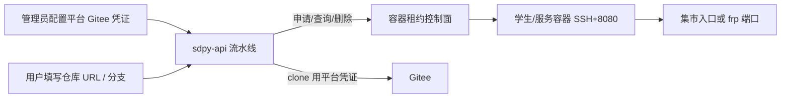

# SSE Deploy 重设计计划：Gitee 源码 + 容器申请流水线

> **状态**：转向执行（2026-08-21 复探后）  
> **日期**：2026-08-19（修订 2026-08-21）  
> **相关 note**：`docs/notes/2026-08-19-k8s与gitee改造方向.md`、`docs/notes/2026-08-21-sseinfra一键部署已就绪.md`  

## 2026-08-21 修订摘要

sseinfra **已实现**「Gitee/GitHub 仓库 + 根目录 `deploy.sh` + supervisord + MinIO/DB 凭证注入」。  
负责人目标（单仓、deploy.sh、一键部署、同构 Ubuntu、后端读桶）**可直接在现网验证**，不必先写 `k8s-runtime-api`。

**近期开工顺序**：

1. 做示例仓库（`deploy.sh` + 前后端 + 读 `MINIO_*`）
2. 在某一组上走通：建桶/发密钥 → 添加部署 → `:23xxx` 访问
3. 再决定 SDPY 是「文档/跳转」还是封装表单 API / 补 JSON

原 P0–P3 中「自建租约控制面」降为可选；优先消费现网 `deploys.py`。

---

## 1. 为什么重设计

当前已落地路径：**用户上传 zip → 本机 docker compose → `/sdpy` 网关反代**。

后续产品形态变成：

1. **源码只从 Gitee 来**（砍 zip 上传）
2. **每个服务单独申请一台机子/容器**（与 WZ8 `student-platform` 同语义）
3. 整条链路要能进 **流水线**（可自动、可审计），而不是老师点网页表单

因此：旧的「本机 compose 部署」与「k8s-runtime-api 上传制品部署」都不能直接当最终架构，需要重新切分职责。

---

## 2. 目标形态（草案）

### 2.1 源码（对齐 iWiki）

| 角色 | 做什么 |
|------|--------|
| 管理员 | 配置平台级 Gitee `username` + `token`（env 或管理后台，env 优先锁定） |
| 用户 | 只填 `repoUrl`（+ 可选 branch/commit），**不贴个人 key** |
| 平台 | 浅克隆 / 拉归档；私有仓用平台凭证重试 |

参考实现：iWiki `code-wiki-git-credentials.ts` + `code-wiki-fetch.ts`。

SDPY 差异（待决）：

- 是否要 **webhook** 触发自动部署（iWiki 目前没有）
- 仓库约定：是否仍要求仓内有 `frontend/`、`backend/`、`compose.yml`，还是改为「进开发机后用户自己装」

### 2.2 容器（对齐 student-platform 语义）

流水线步骤示例：

1. `lease.create` — 申请组/容器（CPU/内存/可选 GPU）
2. 返回：SSH 公网、Web 公网、密码、组名、状态
3. （后续阶段再定）在容器内 clone / build / 起进程，或只把机子交给服务负责人
4. `lease.delete` — 回收

**不要**直接依赖现网 HTML：`POST /add`、`POST /group/<name>/delete`（Cookie+CSRF）。  
应在同一套逻辑上抽 **JSON API**（可先包一层现有 `groups.py`，再演进）。

### 2.3 本机 SDPY 角色收缩

倾向：

- SDPY = **项目/权限/流水线编排 + 入口反代（可选）**
- 算力与容器生命周期 = **WZ8 控制面**
- 本机 docker compose 部署用户模块 = **逐步废弃**（管理平台自身仍可 compose）

---

## 3. 建议分期

### P0 — 契约与凭证（不接生产流量）

- [ ] 定 JSON：`POST /v1/leases`、`GET /v1/leases/:id`、`DELETE /v1/leases/:id`
- [ ] SDPY 管理端：Gitee 平台凭证（抄 iWiki 模式）
- [ ] 模块模型：`repoUrl` / `branch` 替代 zip 包字段（可双轨过渡）
- [ ] 废弃说明：用户文档标注 zip 将下线

### P1 — 控制面可调用

- [ ] WZ8：在 `student-platform` 旁路增加 Bearer Token JSON API（内部调 `create_group` / `delete_group_k8s`）
- [ ] 组名约定：`sdpy-{project}-{module}` 或流水线 job id
- [ ] 配额：现网最多 10 组端口；流水线要扩 frp/NodePort 策略
- [ ] SDPY worker：流水线步骤「申请容器」落库连接信息

### P2 — 源码进机与运行约定

- [ ] 平台凭证 clone 到容器（或构建机）的方式
- [ ] 是否仍跑 compose / 是否只给裸机
- [ ] 公网入口：继续 frp 端口 vs 集市 nginx 反代到 NodePort
- [ ] 审计：谁申请、哪次流水线、何时回收

### P3 — 砍 zip + 文档收口

- [ ] 下线上传包 API/UI
- [ ] 更新 `用户部署约定.md`、作废或改写 `k8s-runtime-api.md`（标明被本计划取代的部分）
- [ ] 清理本机 compose 用户模块路径

---

## 4. 明确不做 / 暂缓

- 直接用面板 HTML 当长期 API
- 用户粘贴个人 Gitee Token
- 在未定「机子里跑什么」之前，实现完整「zip 式 web+api 一键部署到 K8s」
- 把集市机空闲 k3s 与 WZ8 混为一谈（两套集群）

---

## 5. 待你确认的决策

1. **申请到的容器**：只当开发机（SSH），还是平台还要在里面自动 compose/起服务？
2. **Gitee 触发**：仅手动「同步并申请」，还是要 webhook？
3. **控制面落点**：扩 WZ8 `student-platform`，还是新建独立 runtime 服务？
4. **对外访问**：维持 `ssemarket.cn:22xxx/23xxx`，还是统一走域名路径？

确认前 **不写对接代码**，只维护本计划与 notes。

---

## 6. 与历史计划对照

见同日 note，或对话回复中的「之前还有哪些计划」清单。
