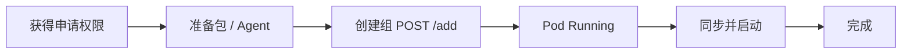
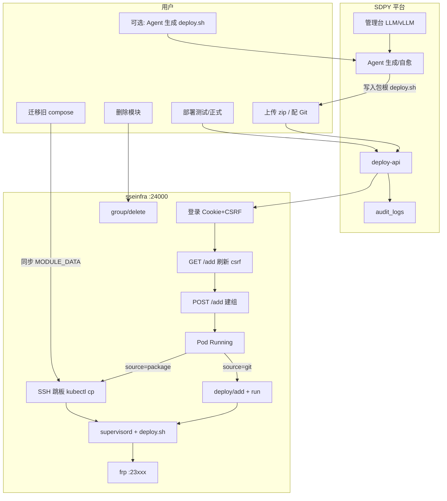
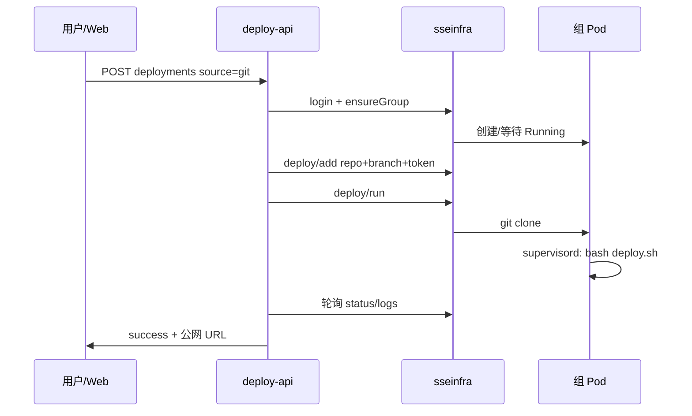
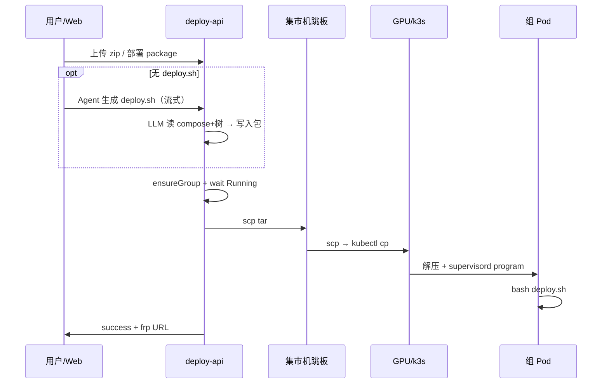
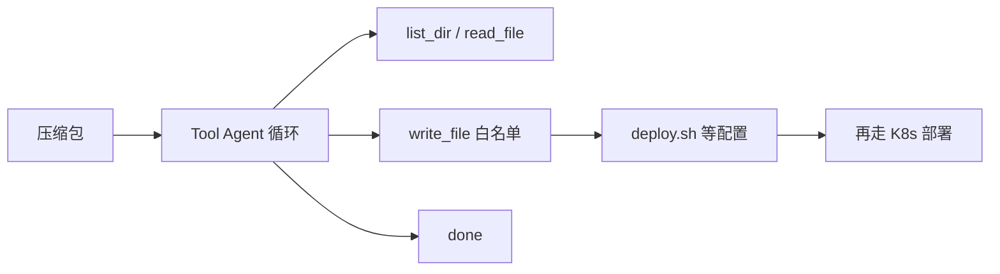

# K8s / sseinfra 部署流水线（流程图）

> 日期：2026-08-21  
> 状态：现行  

## 1. 脚本部署是否可用（结论）

**可用，且为现网硬约定。** sseinfra（student-platform）对服务部署的路径是：

1. 建组 → 学生 Ubuntu Pod  
2. Git：`deploy/add` + `run` → 组内 clone → **supervisord 执行仓根 `deploy.sh`**  
3. Zip（SDPY）：`kubectl cp` 同步目录 → 同样用 supervisord 跑 `deploy.sh`  

组内**无 Docker**，不能直接 `docker compose up`。`deploy.sh` 必须可执行、前台常驻、监听 `0.0.0.0:$PORT`。

证据：组页「服务部署」、`/opt/student-platform` 的 deploys + supervisord；SDPY `SseinfraClient` / `sseinfra-pod.ts`。

---

## 2. 总览流水线



前端模块页有步骤条；「查看日志」弹出浮窗。审计：`audit_logs` + 管理台「审计」Tab。



### 2.1 建组/删组契约（已实测）

| 动作 | 方法 | Path | Form |
|------|------|------|------|
| 登录 | POST | `/login` | `csrf_token, password` |
| 建组页 | GET | `/add` | （刷新 csrf，**必做**） |
| 建组 | POST | `/add` | `csrf_token, name, cpu, mem, storage` |
| 查组 | GET | `/group/{name}` | |
| 删组 | POST | `/group/{name}/delete` | `csrf_token` |

探测脚本：`apps/deploy-api/scripts/probe-sseinfra-fetch.mjs`（2026-08-21 实测：创建 `sdpy-probe-*` → Running → 删除成功）。  
直接 POST `/add` 不先 GET 会报 **「表单已过期」**。

---

## 3. Git 部署泳道



---

## 4. 压缩包部署泳道



---

## 5. 部署 Agent（tools）



- 模型须支持 function calling；无 tools 的端点会失败或空转。  
- 写入边界见 `docs/用户部署约定.md`；实现：`deploy-agent-tools.ts`。

配置入口：管理台 → 管理员 → **AI / vLLM 端点**。

---

## 6. 删除释放

```mermaid
flowchart LR
  Del[删除模块] --> Compose[停本机 compose]
  Del --> K8s[POST /group/t|p/delete]
  K8s --> Free[释放 Pod/PVC/frp]
```

---

## 7. 相关实现

| 能力 | 路径 |
|------|------|
| 流水线 worker | `apps/deploy-api/src/services/deploy-worker.ts` |
| 传包 | `sseinfra-pod.ts` |
| 面板客户端 | `sseinfra-client.ts` |
| LLM / 流式 | `llm.ts` + `ai-custom-endpoints.ts` |
| 生成脚本 | `generate-deploy-sh.ts` |
| 管理台 UI | `AdminView.vue` AI 端点区 |
| 模块 UI | 「Agent 生成 deploy.sh」 |
