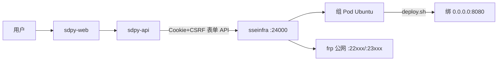

# SSE Deploy × sseinfra 部署方案（执行版）

> **状态**：实现中  
> **日期**：2026-08-21  
> **依据**：`docs/notes/2026-08-21-sseinfra一键部署已就绪.md`

---

## 1. 职责切分

| 层 | 谁 | 做什么 |
|----|-----|--------|
| 编排 / 权限 | **sdpy-api / sdpy-web** | OAuth、项目/模块、审批、填仓库、点部署、看日志与公网地址 |
| 运行时 | **sseinfra**（WZ8） | 建组(Pod)、clone 仓、supervisord 跑 `deploy.sh`、MinIO/DB 注入、frp 公网 |

本机 **不再** 对用户模块执行 `docker compose`（旧路径保留开关，默认关）。



---

## 2. 用户约定（仓库）

仓根必须有可执行 **`deploy.sh`**（sseinfra 硬性检查）。

建议结构（不强制 compose）：

```text
deploy.sh          # 启动前后端 / 反代，读环境变量
frontend/          # 可选
backend/           # 可选，读 MINIO_* / MYSQL_* 等
```

`deploy.sh` 可见环境（标签=组名的凭证才会注入）：

- `PORT`（默认 8080）
- `MINIO_ENDPOINT` / `MINIO_ACCESS_KEY` / `MINIO_SECRET` / `MINIO_BUCKET`
- `MYSQL_*` / `REDIS_*`（若教师发过凭证）

应用须监听 **`0.0.0.0:$PORT`**。

---

## 3. 配置（管理员 / 运维）

| 变量 | 含义 |
|------|------|
| `SSEINFRA_BASE_URL` | 如 `http://ssemarket.cn:24000` |
| `SSEINFRA_PASSWORD` | 面板管理密码（与 `.env` 的 k8s_password 同类） |
| `SSEINFRA_GROUP_PREFIX` | 默认 `sdpy`；组名 = `{prefix}-{module}`（小写） |
| `SSEINFRA_DEFAULT_CPU` / `MEM` / `STORAGE` | 自动建组资源，默认 `2` / `4Gi` / `10` |
| `SSEINFRA_GITEE_TOKEN` | 可选；私有仓部署时注入表单 `token`（用户不贴） |
| `DEPLOY_RUNTIME` | `sseinfra`（默认）\| `compose`（旧本机路径） |

---

## 4. 模块模型

- 主路径：配置 **Gitee/GitHub HTTPS `repoUrl` + branch**（已有字段）
- zip 上传：**UI 降级为高级/隐藏**，默认部署 `source=git` 且走 sseinfra
- 部署记录增加可选字段：`sseinfra_group`、`sseinfra_deploy_id`（迁移列）

组命名：`sdpy-{moduleName}`，全局唯一，对应 sseinfra 一个 group。

---

## 5. 部署流水线（worker）

1. 校验模块有 `repoUrl`
2. `SseinfraClient.login()`
3. 若组不存在 → `POST /add` 创建（CPU/MEM/STORAGE）
4. 等待 Pod Running（轮询组页或有限次重试）
5. `POST /group/<g>/deploy/add`（repo/branch/token）
6. `POST .../deploy/<did>/run`
7. 轮询 `GET .../status`，拉取 `.../logs` 写入 deployment.logs
8. success：`setModuleActiveSlot`，URL 写 sseinfra 公网 Web（如 `http://ssemarket.cn:23001`）

test / prod：首期 **共用同一组** 或 **两组** `sdpy-{m}-test` / `sdpy-{m}-prod`（实现取 **两组**，与现 env 语义对齐）。

---

## 6. 分期

- **本期**：client + worker 切 sseinfra + 前端默认 Git + 文档/示例 `deploy.sh`
- **下期**：管理台发 MinIO/DB 凭证自动化；webhook；砍死 compose
- **可选**：向 sseinfra 要真正 JSON Bearer API
