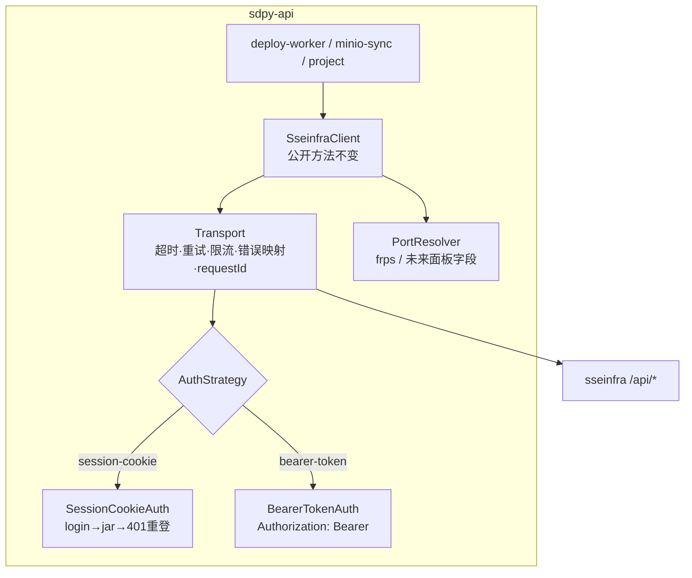

# sdpy × sseinfra：从「面板登录」到「直连 API」改造方案

> **状态**：**部分已实现**（传输/认证层已 JSON API 化；Bearer Token 待 sseinfra 补齐 `/api/tokens`）
> **日期**：2026-09-09
> **依据**：`https://cloud.ssemarket.cn/docs`（线上文档 SPA）+ 线上接口实测
> **目标**：sdpy 不再依赖「用户名密码换 Flask session cookie」的面板登录态，改为标准 API 认证，更稳定、更可靠、可观测

---

## 实现进度（2026-09-11 复核）

| 阶段 | 状态 | 说明 |
|---|---|---|
| 面板 SPA 重构适配（HTML 抓取 → JSON API） | ✅ 已完成 | 认证改 `POST /api/auth/login`（JSON）+ session cookie；`/api/*` 豁免 CSRF；组→pod（`/api/pods/…`）。见 [2026-09-11 更新说明](../notes/2026-09-11-部署流水线可靠性修复与sseinfra客户端JSON-API迁移.md) |
| 端口解析（frps dashboard） | ✅ 已完成 | `GET {frps}/api/proxy/tcp` 取 `grp-<组>-web` 的 `remotePort` → `idx` → Web `23000+idx` / SSH `22000+idx` |
| 认证抽象（`SessionCookieAuth` / `BearerTokenAuth` 双模式） | ⏸ 未做 | 依赖 sseinfra 后端提供 `/api/tokens`（实测仍 404），当前仅 session cookie 一种模式 |
| 传输层标准化（独立 `transport.ts`） | ⏸ 未做 | 现状仍内聚在 `SseinfraClient.request()`；已具备写前重登、错误映射 |
| 统一 Bearer 切换 | ⏸ 未做 | 阻塞于上游 |

> 小结：**「不再抓 HTML」这一核心目标已达成**；「Bearer Token」那一半仍等上游。
> 本文余下章节保留原始设计推演，供后续接续。

---

## 0. 一句话结论

sseinfra 官方文档**已声明支持 `Authorization: Bearer <token>`**，但**线上后端尚未提供 token 签发端点**（`/api/tokens` 实测 404）。
因此本方案分两段走：**先把传输层/认证层标准化（不改外部契约）→ 等 sseinfra 补齐签发端点后，一行配置切到 Bearer**。

---

## 1. 现状盘点

### 1.1 线上文档确认的认证方式

文档「API 参考 → 认证」原文：

> 所有 API 端点以 `/api` 前缀开头，支持两种认证方式：
> - **Session Cookie** — 登录后自动设置，浏览器请求默认携带
> - **Bearer Token** — 在 `Authorization` 头传入 `Bearer <token>`

### 1.2 实测结果（2026-09-09）

| 探测项 | 结果 | 说明 |
|---|---|---|
| `POST /api/auth/login` | `200` + `Set-Cookie: session=…` | 当前 sdpy 走的路径，响应体**不含 token** |
| `GET /api/auth/me`（带 cookie） | `200 is_logged_in:true` | 正常 |
| `GET /api/auth/me`（`Bearer <session值>`） | `200 is_logged_in:false` | **session 值不能当 Bearer 用** |
| `GET /api/tokens` | `404 NOT_FOUND` | 前端有 UI，后端未实现 |
| `POST /api/tokens` | `404 NOT_FOUND` | 同上 |
| `GET /api/auth/csrf` | `404 NOT_FOUND` | 前端 client 会调，失败后降级为空 |
| `GET /api/pods/:name` | `200` | 字段**不含** web/ssh 端口 |
| `GET /api/pods/:name/credentials` | `200 {"databases":[],"minio":[]}` | 只有 DB/MinIO 凭证 |
| `GET /api/infra/proxy` | `200 {mappings:[{id,subdomain,port,note,enabled}]}` | 是**子域名反代映射**，不是 Pod 端口 |

### 1.3 前端已存在但后端未实现的 token 管理 UI

从线上 `assets/users-D2uNDwqi.js` 反查，用户管理页有「API Token」区块：

```js
// GET  /api/tokens            → { tokens: [{ description, prefix, created_at, last_used_at }] }
// POST /api/tokens            → { token | key }        （创建后仅回显一次）
// POST /api/tokens/delete     → { id }                  （删除）
```

> **结论**：sseinfra **前端已上线、后端未落地**。这是本方案的关键外部依赖。

### 1.4 sdpy 当前实现

| 文件 | 职责 |
|---|---|
| `apps/deploy-api/src/services/sseinfra-client.ts` | 唯一 HTTP 客户端：`login()` 换 cookie → 全部调用带 cookie |
| `apps/deploy-api/src/services/sseinfra-settings.ts` | 配置读写（DB `platform_settings` + env 覆盖） |
| `apps/deploy-api/src/services/deploy-worker.ts` | 部署编排（3 处 `new SseinfraClient()`） |
| `apps/deploy-api/src/services/project.ts` | 删组（1 处） |
| `apps/deploy-api/src/services/applications.ts` | 对象存储供给（1 处） |
| `apps/deploy-api/src/services/minio-sync.ts` | MinIO 同步（4 处） |
| `apps/deploy-api/src/routes/admin.ts` | 管理台连通性/配置（1 处） |

当前认证核心：

```132:200:apps/deploy-api/src/services/sseinfra-client.ts
  async request(path: string, init: { method?: string; json?: unknown; body?: string; headers?: HeadersInit } = {}): Promise<ApiResult> {
    const headers = new Headers(init.headers as HeadersInit | undefined);
    const cookie = cookieHeader(this.jar);
    if (cookie)
      headers.set('cookie', cookie);
    // ...
  }

  async login(): Promise<void> {
    // ...
    this.jar.clear();
    const res = await this.request('/api/auth/login', {
      method: 'POST',
      json: { username: this.username, password: this.password },
    });
    // ...
  }

  /** 写操作前重登：面板 session 偶发过期，改状态前都强制新会话 */
  async beforeWrite(): Promise<void> {
    await this.login();
  }
```

**现存问题**：
1. 每次写操作前都 `login()`（`beforeWrite`），5 次失败锁 5 分钟的风险被放大。
2. session 过期只能靠 401 兜底重登，无统一重试/退避。
3. 密码是长期凭据且全权，泄露面大；Bearer 可按用途/有效期收敛。
4. 无 request-id、无超时分级、无限流处理，排障靠日志文本。

---

## 2. 改造目标与原则

| 目标 | 说明 |
|---|---|
| **认证可切换** | 同一份业务代码，配置决定走 `session-cookie` 还是 `bearer-token` |
| **业务零改动** | `SseinfraClient` 的**公开方法签名保持不变**，8 处调用点不动 |
| **传输层加固** | 统一超时、重试退避、限流处理、错误码映射、request-id |
| **可观测** | 每次调用带 `X-Sdpy-Request-Id`，日志可对账 |
| **可回滚** | 配置回切即恢复现状，不需重新发版 |

---

## 3. 目标架构



**分层职责**：

- `Transport`：只关心 HTTP 语义（超时、重试、状态码、错误体），不关心认证。
- `AuthStrategy`：只负责「怎么让请求被认证」+ 「401 时怎么自愈」。
- `SseinfraClient`：业务语义（组/部署/环境变量/存储），签名不变。
- `PortResolver`：把组名解析成公网 Web/SSH 地址（当前 frps，未来可换官方字段）。

---

## 4. 分阶段实施

### Phase 1 — 传输层标准化（不改外部行为，可独立上线）

**新增** `apps/deploy-api/src/services/sseinfra/transport.ts`

```ts
export type TransportOpts = {
  baseUrl: string;
  auth: AuthStrategy;
  log?: (line: string) => void;
  timeoutMs?: number;      // 默认 15s
  retry?: { max: number; baseMs: number };  // 默认 2 次，指数退避
  requestId?: () => string;
};
```

职责：
1. **超时分级**：读 15s / 写 30s / 上传 120s（可配）。
2. **重试策略**：仅对 **幂等**（GET/HEAD）与 **429/502/503/504/网络错误** 重试；POST 写操作**默认不重试**（避免重复建组），除非调用方显式 `retryOnWrite`。
3. **限流处理**：`429` 读 `Retry-After`，无则退避 `1s → 2s → 4s`。
4. **错误码映射**：把 `{"error":{"code","message"}}` 统一成 `SseinfraApiError { code, status, message, details }`。
5. **可观测**：请求头注入 `X-Sdpy-Request-Id: <uuid>`，日志带同 id。

**验收**：`sseinfra-client.ts` 行为等价（现有 8 处调用全部通过），新增日志可见 request-id 与重试次数。

---

### Phase 2 — 认证策略抽象（为 Bearer 铺路）

**新增** `apps/deploy-api/src/services/sseinfra/auth.ts`

```ts
export interface AuthStrategy {
  readonly kind: 'session-cookie' | 'bearer-token';
  /** 首次调用前准备（session 模式=登录；bearer=校验非空） */
  prepare(): Promise<void>;
  /** 给请求加认证头 */
  apply(headers: Headers): void;
  /** 401 自愈：返回 true 表示已刷新，可重试一次 */
  refresh(): Promise<boolean>;
}
```

两种实现：

| 实现 | 行为 | 适用 |
|---|---|---|
| `SessionCookieAuth` | `POST /api/auth/login` → jar → 401 时重登一次 | 现状兜底 / 无 token 时 |
| `BearerTokenAuth` | `Authorization: Bearer <token>`，**无 login、无 CSRF** | 目标形态 |

**选择逻辑**（`resolveAuth()`）：
```
if (SSEINFRA_API_TOKEN || platform_settings.sseinfra_api_token) → BearerTokenAuth
else                                                            → SessionCookieAuth
```

> **关键收益**：`beforeWrite()` 在 Bearer 模式下退化为 no-op，彻底消除「每次写操作重登」和「5 次锁定」风险。

**验收**：配置 `SSEINFRA_API_TOKEN` 后，日志不再出现 `POST /api/auth/login`，所有 `/api/*` 带 `Authorization: Bearer`。

---

### Phase 3 — 端口解析抽象（消除 frps 硬依赖）

**现状**：`frpsProxyMap()` 直连 frps dashboard（`http://172.17.0.1:7501`），把 `grp-<组名>-web` 的 `remotePort` 反推 `23000+idx`。这依赖 frps 内部约定，且账密硬编码默认值。

**新增** `apps/deploy-api/src/services/sseinfra/port-resolver.ts`

```ts
export interface PortResolver {
  resolve(group: string): Promise<{ webUrl: string; sshHint: string }>;
}
```

- `FrpsPortResolver`（默认，行为与现状一致，保留 60s 缓存）
- `PanelPortResolver`（预留：等 sseinfra 在 `/api/pods/:name` 暴露 `web`/`ssh` 字段后切换）

**同时修正**：
- frps 账密默认值 `admin/SSE_Market` 改为**必填配置**，缺失时明确报错而非静默使用弱默认。
- 解析失败时日志区分「frps 不可达」与「该组无映射」，便于排障。

> **为什么不直接用 `/api/infra/proxy`**：实测该端点返回的是**子域名反代映射**（`id/subdomain/port/note`），语义是「子域名 → Pod+端口」，与「组名 → 公网端口」不同，无法替代。

---

### Phase 4 — 配置与管理台

**新增配置项**（`sseinfra-settings.ts`）：

| 键 | env | 说明 |
|---|---|---|
| `sseinfra_api_token` | `SSEINFRA_API_TOKEN` | Bearer token；为空则回落 session 登录 |
| `sseinfra_api_token_expires_at` | — | 可选，到期提醒 |
| `sseinfra_frps_url/user/pass` | `SSEINFRA_FRPS_*` | 从硬编码默认值改为显式配置 |

**管理台 UI**（`apps/deploy-web` 的 sseinfra 设置区）：
- Token 输入框（写入后仅显示 `prefix…` 掩码，与现有 `maskSecret` 一致）
- 「测试连通性」按钮 → 后端 `GET /api/auth/me` + `GET /api/pods/?per_page=1`，回显**当前认证方式**（cookie / bearer）与角色
- Token 到期倒计时提示

**安全**：
- Token 只存 DB / env，日志与接口响应一律脱敏。
- 审计日志记录「谁在何时更新了 token」（复用现有审计）。

---

### Phase 5 — 灰度与回滚

| 步骤 | 动作 | 回滚 |
|---|---|---|
| 1 | 上线 Phase 1（传输层） | 无行为变更 |
| 2 | 上线 Phase 2（认证抽象），默认仍 session | 无需回滚 |
| 3 | sseinfra 补齐 `/api/tokens` 后，管理台填入 token | 清空 token → 自动回落 session |
| 4 | 观察 1 周，确认无 401 风暴 | 同上 |

**灰度开关**：`SSEINFRA_AUTH_MODE=session|bearer|auto`（默认 `auto`）。

---

## 5. 外部依赖（需要 sseinfra 侧配合）

sdpy 需要的最小契约：

```http
### 1. 创建 token（管理员）
POST /api/tokens
Content-Type: application/json

{ "description": "sdpy-deploy", "expires_in": 0 }

→ 201 { "token": "<明文，仅此一次>", "prefix": "sse_abc1", "created_at": "2026-09-09T..." }

### 2. 列出 token
GET /api/tokens
→ 200 { "tokens": [{ "id", "description", "prefix", "created_at", "last_used_at" }] }

### 3. 删除 token
POST /api/tokens/delete
Content-Type: application/json

{ "id": "<id>" }
→ 200 { "ok": true }
```

**权限要求**：token 需能调用 sdpy 用到的全部端点（`pods.*`、`infra.storage.*`）。
**建议**：token 支持 scope 收敛（最小权限），避免等同超级管理员。

---

## 6. 工作量与风险

| 阶段 | 预估 | 风险 | 缓解 |
|---|---|---|---|
| Phase 1 传输层 | 1.5d | 重试导致重复建组 | 写操作默认不重试 |
| Phase 2 认证抽象 | 1d | 双模式分支遗漏 | 类型穷尽 + 单测覆盖两模式 |
| Phase 3 端口解析 | 1d | frps 账密缺失导致解析失败 | 明确报错 + 配置校验 |
| Phase 4 配置/UI | 1d | Token 泄露 | 脱敏 + 审计 |
| Phase 5 灰度 | 0.5d | 401 风暴 | auto 回落 + 监控告警 |

**总预估**：约 5 人日（不含 sseinfra 后端实现 `/api/tokens`）。

---

## 7. 不做的事

- ❌ 不改造 sseinfra 后端（不在本仓库范围；仅提契约）
- ❌ 不改 `SseinfraClient` 公开方法签名（避免 8 处调用点连带改动）
- ❌ 不引入新的 HTTP 库（沿用内置 `fetch`，减少依赖）
- ❌ 不用 `/api/infra/proxy` 替代 frps 端口解析（语义不符，见 §4 Phase 3）

---

## 8. 落地检查清单

- [ ] `transport.ts`：超时/重试/限流/错误映射/request-id
- [ ] `auth.ts`：`SessionCookieAuth` + `BearerTokenAuth` + `resolveAuth()`
- [ ] `port-resolver.ts`：`FrpsPortResolver`（行为等价）+ `PanelPortResolver`（预留）
- [ ] `sseinfra-settings.ts`：新增 token / frps 配置项
- [ ] 管理台：Token 输入 + 掩码 + 连通性测试 + 认证方式回显
- [ ] 单测：两种认证模式的请求头、401 自愈、限流退避
- [ ] 文档：更新 `docs/plans/2026-08-21-sseinfra部署执行方案.md` 的「可选：向 sseinfra 要真正 JSON Bearer API」
- [ ] sseinfra 侧：`/api/tokens` 三个端点上线
